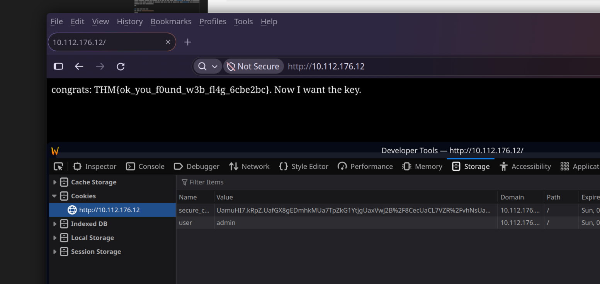
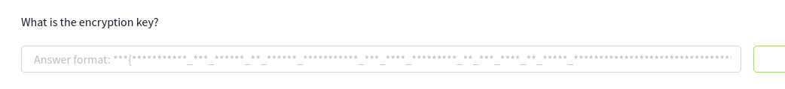

# Crypto Failures
## Implementing your own military-grade encryption is usually not the best idea.
Difficulty: Medium
URL: https://tryhackme.com/room/cryptofailures

### Info given

First exploit the encryption scheme in the simplest possible way, then find the encryption key.

### Tasks
- What is the value of the web flag?
- What is the encryption key?


# Content
# Part 1, web flag

Dit is een crypto challenge, maar toch voor de zekerheid nmap draaien;
>$ sudo nmap -sCV 10.114.131.3
```log
Starting Nmap 7.98 ( https://nmap.org ) at 2026-11-08 22:28 +0100
Nmap scan report for 10.114.131.3
Host is up (0.013s latency).
Not shown: 998 closed tcp ports (reset)
PORT   STATE SERVICE VERSION
22/tcp open  ssh     OpenSSH 8.9p1 Ubuntu 3ubuntu0.7 (Ubuntu Linux; protocol 2.0)
| ssh-hostkey: 
|   256 57:2c:43:78:0c:d3:13:5b:8d:83:df:63:cf:53:61:91 (ECDSA)
|_  256 45:e1:3c:eb:a6:2d:d7:c6:bb:43:24:7e:02:e9:11:39 (ED25519)
80/tcp open  http    Apache httpd 2.4.59 ((Debian))
|_http-title: Did not follow redirect to /
|_http-server-header: Apache/2.4.59 (Debian)
Service Info: OS: Linux; CPE: cpe:/o:linux:linux_kernel

Service detection performed. Please report any incorrect results at https://nmap.org/submit/ .
Nmap done: 1 IP address (1 host up) scanned in 7.84 seconds
```
Zoals verwacht een webserver.

Op de website staat:
You are logged in as guest:**********************************************************************

SSO cookie is protected with traditional military grade en**crypt**ion 

>$ gobuster dir -u http://10.114.131.3 -w gobuster_wordlist.txt 
```log
===============================================================
Gobuster v3.8.2
by OJ Reeves (@TheColonial) & Christian Mehlmauer (@firefart)
===============================================================
[+] Url:                     http://10.114.131.3
[+] Method:                  GET
[+] Threads:                 10
[+] Wordlist:                gobuster_wordlist.txt
[+] Negative Status codes:   404
[+] User Agent:              gobuster/3.8.2
[+] Timeout:                 10s
===============================================================
Starting gobuster in directory enumeration mode
===============================================================
index.php            (Status: 302) [Size: 0] [--> /]
.htaccess            (Status: 403) [Size: 277]
config.php           (Status: 200) [Size: 0]
.htpasswd            (Status: 403) [Size: 277]
.htpasswds           (Status: 403) [Size: 277]
Progress: 1828 / 1828 (100.00%)
===============================================================
Finished
===============================================================
```

Er zijn 2 cookies;
|Name|Value|
|---|---|
|secure_cookie|53OSq0P5Ubdu.53AZnD5Qtm/kc53PjXSqOYj3Uc539xvJw3XEL6g53WmYh7yVa2uc53YnaAejq/28653I731HJGtJ5s53Tz6xczcZLTY53QHKoYn8Zof653/0c2U6LCD5Y53XO3Ja7MDHzI53YLhqymvMCCE53POglP6Fe4Gg534uv9dbT5yjM53hO1h4SwHLbQ534HozINePTgo535ATp7Rw5rc253jwra57V2ZLA53zp7dYdbJge.5372Bz13.Glvk53GQeZa7OlRrE53azYdplaO7Nk537/K3pq4g3gc53i0NXC/OtV.Y53brgZreJ8BKc53mo/2GRx7px.53THaqeV91Qcc539mU9.aHGYcI53fZxfrq1EdP2|
|user||guest|

Q: Kunnen we van `guest` `admin` maken?
A: Nee dan zegt die dat ik niet ben ingelogd, dus er gebeurt wel iets van check.

Ik zie niet echt iets in de javascript op de website.

Bij het initial GET request worden beide de `secure_cookie` en `user` cookie meegegeven.

In de raw HTML staat ook een comment;
`<!--TODO remember to remove .bak files-->`
Uit gobuster weten we dat er een `index.php`, `config.php` bestaat.

http://10.114.131.3/index.php -> Main page
http://10.114.131.3/config.php -> Empty
http://10.114.131.3/index.php.bak -> 1.9kB bestand.
http://10.114.131.3/config.php.bak -> Not found


In het PHP script wat we krijgen staat;
```php
if ($user === "admin") {
   
        echo 'congrats: ******flag here******. Now I want the key.';
```
Dus we moeten duidelijk gaan voor de user `admin`.

Er zijn een paar functies:
- generate_cookie
- cryptstring
- generatesalt
- verify_cooking

We hebben blijkbaar niet de key nodig voor stap 1.
De **crypt** is wel duidelijk nu, omdat het PHP `crypt` functie gebruikt.

Warning op de PHP documentatie https://www.php.net/manual/en/function.crypt.php:
```log
None of the algorithms listed below are suitable for hashing new passwords. CRYPT_STD_DES, CRYPT_EXT_DES and CRYPT_MD5 are far too fast to resist offline cracking; md5crypt was declared end of life for that reason (CVE-2012-3287). The runtime of CRYPT_SHA256 and CRYPT_SHA512 grows with the square of the length of string, so unbounded input can be used to exhaust CPU (CVE-2016-20013). Use password_hash() instead, which selects a suitable algorithm and cost automatically. 
```

### Stel crypt doet niks
Dan krijg je `index_nocrypt.php`;
```php
function generate_cookie($user,$ENC_SECRET_KEY) {
    $SALT=generatesalt(2);
    
    $secure_cookie_string = $user.":".$_SERVER['HTTP_USER_AGENT'].":".$ENC_SECRET_KEY;

    $secure_cookie = secure_cookie_string

    setcookie("secure_cookie",$secure_cookie,time()+3600,'/','',false); 
    setcookie("user","$user",time()+3600,'/','',false);
}

function make_secure_cookie($text,$SALT) {
    return($text);
}
```
In dat scenario is de $ENC_SECRET_KEY direct af te lezen, want `.` doet alleen concatenate.

De originele versie doet crypt in blokken van 8, **en het gebruikt elke keer dezelfde salt** (2 random letters).
```php
function generate_cookie($user,$ENC_SECRET_KEY) {
    $SALT=generatesalt(2);
    
    $secure_cookie_string = $user.":".$_SERVER['HTTP_USER_AGENT'].":".$ENC_SECRET_KEY;

    $secure_cookie = make_secure_cookie($secure_cookie_string,$SALT);

    setcookie("secure_cookie",$secure_cookie,time()+3600,'/','',false); 
    setcookie("user","$user",time()+3600,'/','',false);
}

function cryptstring($what,$SALT){
    return crypt($what,$SALT);
}


function make_secure_cookie($text,$SALT) {
    $secure_cookie='';
    foreach ( str_split($text,8) as $el ) {
        $secure_cookie .= cryptstring($el,$SALT);
    }
    return($secure_cookie);
}
```
- `str_split($text,8)` split op 8 characters.
- `$secure_cookie_string = $user.":".$_SERVER['HTTP_USER_AGENT'].":".$ENC_SECRET_KEY;` Zet de secret helemaal op het einde, dus we hoeven alleen het eerste stuk van de cookie te veranderen lol.
- We moeten eerst een script hebben wat de salt kan uitrekenen, we kunnen dit valideren tegen de originele cookie die start met `guest:Mo`.
- Als we de salt hebben, dan kunnen we dit eerste stuk ook uitrekenen voor `admin:Mo`
- Eerste 8 characters aanpassen in de cookie zou dan OK moeten zijn.

Hoeft niet eens! Van de PHP documentatie. Dus we weten wat de salt is!
`The standard DES-based crypt() returns the salt as the first two characters of the output. `
Omg;
secure_cookie=MAQ55hx59Xoc6MAB0vELZMxT12MAG95sRn3ShaAMAilFSJfZK0gkMAJVl1hv/HiXwMAm4nc9Zug.fEMAyFFy/62phtgMAxkvPnEjvwlYMA.b3dMP6Qtn6MAh10VEOn4QWQMADH6Yr2eiR9QMA6iZ.gHAlFtEMA5ehYo22HShUMA64rWOnfxdDsMASdhoaQhzY7IMApsGQbC3WphkMApRdg.dVlGgcMA5CKIyPZlSiQMAV9TKiJ2FljYMAfOJJxXj6I4QMAZB4Ldc7h2pcMAxdwcrBVTgssMAfYNDmDRgINUMA1wwPjDL9BY.MAuWvzzAWfLWQMAAxTsDcFt4aQMAzKvfPzj2GXwMAUXbdyjPpwMIMAFr2sN558OowMALglWua/bKnYMAfUUxNZAT4AoMANmz1hp3QddEMA8yhKYOvo0KkMAiiFr9J6yXrE
Opknippen in stukken;
```log
secure_cookie=
MAQ55hx59Xoc6
MAB0vELZMxT12
MAG95sRn3ShaA
MAilFSJfZK0gk
MAJVl1hv/HiXw
MAm4nc9Zug.fE
MAyFFy/62phtg
MAxkvPnEjvwlY
MA.b3dMP6Qtn6
MAh10VEOn4QWQ
MADH6Yr2eiR9Q
MA6iZ.gHAlFtE
MA5ehYo22HShU
MA64rWOnfxdDs
MASdhoaQhzY7I
MApsGQbC3Wphk
MApRdg.dVlGgc
MA5CKIyPZlSiQ
MAV9TKiJ2FljY
MAfOJJxXj6I4Q
MAZB4Ldc7h2pc
MAxdwcrBVTgss
MAfYNDmDRgINU
MA1wwPjDL9BY.
MAuWvzzAWfLWQ
MAAxTsDcFt4aQ
MAzKvfPzj2GXw
MAUXbdyjPpwMI
MAFr2sN558Oow
MALglWua/bKnY
MAfUUxNZAT4Ao
MANmz1hp3QddE
MA8yhKYOvo0Kk
MAiiFr9J6yXrE
```
Begint allemaal met "MA", dat is dus de salt. Hier is ook te zien dat het lijkt alsof sommige stuken langer zijn, ik weet nog niet waarom.

Dus we hebben nodig aan script:
```
function cryptstring($what,$SALT){
    return crypt($what,$SALT);
}
```
- Met $SALT iets wat we uit de eerste 2 tekens van de cookie halen.
- $what is "admin:Mo"
- Check tov "guest:Mo", dat dit hetzelfde geeft als de secure cookie.

```
<?php
// crypt.php

function cryptstring($what, $SALT) {
    return crypt($what, $SALT);
}

if ($argc < 3) {
    fwrite(STDERR, "Gebruik: php crypt.php <input> <salt>\n");
    exit(1);
}

$input = $argv[1];
$salt  = $argv[2];

echo cryptstring($input, $salt), PHP_EOL;
```

>$ php run_crypt.php guest:Mo MA
>MAQ55hx59Xoc6

Klopt! Dus hiermee kunnen we task 1 oplossen!

Voor de challenge:
`UaYc0.1HkcHawUafGX8gEDmhkMUa7TpZkG1YtjgUaxVwj2B/8CecUaCL7VZR/vhNsUaOFJoqrmSxj2UabPY7Jh80zuEUa/G5/Mw4/CzkUab9a3UDALAJ6UaCcP2fvKdbIcUaiu7nI2PN0JQUaPRbfleTs5gsUaTkGnCIZfyuYUaEBuXbZfUU7gUajgVnedqiO7wUaiexZFiuVdDIUaE.5IMv/XT4.UaTrGy2s797tIUa5uXzwwh5mlEUarNFAdY6jGN6Ua5C3v5GIikgsUagfyt0h5NoF.UaKDf/g15dSmEUautT1ereakJwUa6fCWLGvV32cUa0daKUoKDIC2UabF33b0zDyvkUaiHwXZOGTWFwUav6oetGPR1mk`
Dus de salt is `Ua`

>$ php run_crypt.php admin:Mo Ua
>UamuHI7.kRpZ.


FLAG: THM{ok_you_f0und_w3b_fl4g_6cbe2bc}

```log
UaYc0.1HkcHaw
UafGX8gEDmhkM
Ua7TpZkG1Ytjg
UaxVwj2B/8Cec
UaCL7VZR/vhNs
UaOFJoqrmSxj2
UabPY7Jh80zuE
Ua/G5/Mw4/Czk
Uab9a3UDALAJ6
UaCcP2fvKdbIc
Uaiu7nI2PN0JQ
UaPRbfleTs5gs
UaTkGnCIZfyuY
UaEBuXbZfUU7g
UajgVnedqiO7w
UaiexZFiuVdDI
UaE.5IMv/XT4.
UaTrGy2s797tI
Ua5uXzwwh5mlE
UarNFAdY6jGN6
Ua5C3v5GIikgs
Uagfyt0h5NoF.
UaKDf/g15dSmE
UautT1ereakJw
Ua6fCWLGvV32c
Ua0daKUoKDIC2
UabF33b0zDyvk
UaiHwXZOGTWFw
Uav6oetGPR1mk
```

# Part 2, key

De key is blijkbaar erg lang, dus er is no way dat dit een bruteforce (in een keer) ding is.
We weten wel dat:
- `crypt` werkt op blokken van 8
- Volgens PHP documentatie is de DES versie te langzaam voor secure hashing
- Kunnen we blokken van 8 characters wel bruteforcen? Misschien wel, is 41-48 bits per blok.
- Alles hier moet offline kunnen.

Het idee:
- PHP script wat een salt inneemt, en een ding wat we proberen te vinden. E.g. Salt=Ua en zoeken Ua0daKUoKDIC2
- Script probeert dan alle opties uit `0123456789abcdefghijklmnopqrstuvwxyzABCDEFGHIJKLMNOPQRSTUVWXYZ_{}` totdat het matcht
- Dit blok-voor-blok doen totdat we de hele key hebben!

We hebben een PHP oplossing maar die is veel te langzaam. Blijkbaar kan het ook met Hashcat volgens Qwen.

>hashcat -m 1500 -a 3 hashes.txt -1 0123456789abcdefghijklmnopqrstuvwxyzABCDEFGHIJKLMNOPQRSTUVWXYZ_{} ?1?1?1?1?1?1?1?1 --increment

Dit gaat best snel, maar het vindt de oplossing niet super snel.

Let op dat in de originele cookie staat `%2F` dat is URL encoding voor `/`!

Hashcat results:
```log
MAiiFr9J6yXrE:525b9}
```
Dit geeft uiteindelijk de oplossing, maar het moet slimmer kunnen. De RTX4090 gaat met 2.2GH/s, daarmee duurt het 40 uur. De flag eindigt sowieso op `525b9}`, die hebben we al gevonden!

We weten ook dat de key altijd concatenated achteraan is. Ik denk ergens dat we die truc kunnen doen uit introduction to modern crypto, waarbij we steeds 1 character per keer kunnen doen. Daar moet ik script voor hebben.

Idee van script:
- Hele string is: `$user.":".$_SERVER['HTTP_USER_AGENT'].":".$ENC_SECRET_KEY`
- We weten dat die crypt werkt op blokken van 8 characters
- Zet HTTP_USER_AGENT op `""` voor het gemak, dan is de string `$user.":".":".$ENC_SECRET_KEY`
- Maak user 8N+6 characters met N>>1. 

Stel secret key is 123456789 deze zit helemaal in eigen blok:
`[........][........][......::]123456789`

Laatste blok ene kleiner maken 
`[........][........][.....::?]`
Dan hebben we dus een blok waarvan 7/8 characters bekend zijn, en er nog ~(10+26+26+3) attempts nodig zijn.
`[........][........][....::1?]`
`[........][........][...::12?]`
`[........][........][..::123?]`
etc etc
Zo gaat het van $B\times(10+26+26+3)^8\approx10^{14} B$ naar $8B\times(10+26+26+3)=520B$, met $B$ het aantal blokken in de key.